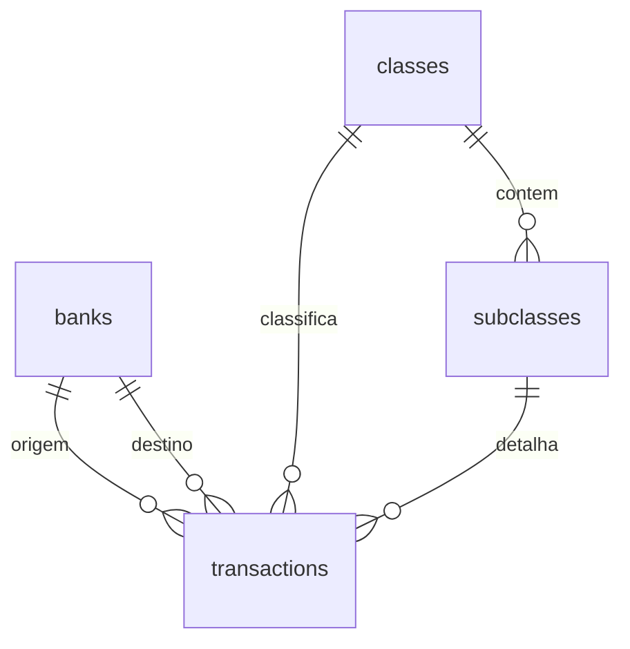

# FinBack local

SPA de finanças pessoais, só no navegador. Sem servidor e sem fallback para banco em memória: se o OPFS não abrir, a interface mostra o erro e não grava nada.

A execução segue [AGENTS.md](AGENTS.md), [CONTEXT.md](CONTEXT.md), [`.cursor/rules/ui.mdc`](.cursor/rules/ui.mdc) e [`.cursor/rules/sqlite.mdc`](.cursor/rules/sqlite.mdc). Não reabre o que esses arquivos já fecharam. A skill grill-me não entra neste MVP.

## O que a execução obedece

- Pastas: `src/components/` (tela e classes Tailwind no mesmo arquivo), `src/db/` (worker, client, schema), `src/hooks/` (a tela chama o hook, o hook chama o client), `src/lib/` só para dinheiro e data. [`src/App.tsx`](src/App.tsx) junta as rotas.
- Sem `src/features/`, `src/services/` ou `src/database/`. Sem provider e sem segunda conexão. O client é um singleton do módulo: um worker para a origem.
- SQL e a validação que o `CHECK` não cobre ficam no worker. [`src/db/client.ts`](src/db/client.ts) só faz `postMessage`. Componente não contém `SELECT`, `INSERT` nem nome de tabela.
- Um arquivo por tela. Extrair outro componente só quando o bloco repetir ou o arquivo ficar difícil de ler. O shell de navegação é [`src/components/Layout.tsx`](src/components/Layout.tsx) porque as três rotas compartilham o mesmo menu.
- Sem CSS de componente. O único CSS é a entrada do Tailwind que o Vite exige (`src/index.css` com `@import "tailwindcss"`).
- Dinheiro e data passam por [`src/lib/money.ts`](src/lib/money.ts) e [`src/lib/dates.ts`](src/lib/dates.ts). O JSX não formata centavo na mão.
- Comentário só para decisão que o código não mostra. O caso previsto é o worker: `SyncAccessHandle` só existe fora da main thread.
- Ao fim de cada etapa (schema, cada tela, persistência), atualizar em [CONTEXT.md](CONTEXT.md) só três blocos: o que funciona, o ponteiro do banco e o próximo passo. Não copiar SQL para lá. Quando [`src/db/schema.sql`](src/db/schema.sql) existir, ele é a fonte da verdade.

## Stack

- Vite + React + TypeScript, roteamento com React Router.
- Tailwind CSS (plugin oficial do Vite).
- SQLite oficial via [`@sqlite.org/sqlite-wasm`](https://github.com/sqlite/sqlite-wasm), VFS `opfs-sahpool`.
- Esse VFS persiste no OPFS e não exige os headers COOP/COEP. A conexão fica num Web Worker dedicado, porque o OPFS só entrega `SyncAccessHandle` em worker.
- Limitação conhecida: uma conexão por origem. Uma segunda aba recebe a mensagem de que o FinBack já está aberto.

Em [`vite.config.ts`](vite.config.ts): `optimizeDeps.exclude` de `@sqlite.org/sqlite-wasm` e `worker.format: 'es'`. Sem headers COOP/COEP.

## Modelo

Dinheiro em centavos (`INTEGER`), moeda única BRL. Data civil `YYYY-MM-DD`. Textos da interface em português.

- `banks`: `id`, `name` único, `created_at`, `updated_at`.
- `classes`: `id`, `name` único, timestamps.
- `subclasses`: `id`, `class_id` obrigatório, `name`, único por classe, timestamps.
- `transactions`:
  - `type` em `debit`, `credit`, `transfer`, `demonstrative`
  - `bank_id` sempre obrigatório (na transferência, é a origem)
  - `destination_bank_id` obrigatório só em transferência, e diferente da origem; nulo nos outros tipos
  - `class_id` e `subclass_id` opcionais; se houver subclasse, a classe é obrigatória e tem de ser a dona da subclasse (trigger)
  - `title` obrigatório; `description` e `notes` opcionais
  - `amount_cents` inteiro maior que zero
  - `occurred_on`
- `PRAGMA foreign_keys = ON`. Exclusão de banco, classe ou subclasse usados por lançamento é recusada (`ON DELETE RESTRICT`). O worker devolve o erro em português; a tela só exibe a mensagem do RPC.
- Tabela `schema_migrations` com a versão 1, para migrações futuras. Relatórios, orçamentos, importação e recorrência ficam fora desta entrega.
- O `CREATE TABLE` vive só em [`src/db/schema.sql`](src/db/schema.sql). O worker importa esse arquivo. Não duplicar o SQL no plano, no `CONTEXT.md` nem nas rules.

Efeito no saldo do banco:

- crédito soma em `bank_id`
- débito subtrai de `bank_id`
- transferência subtrai da origem e soma no destino
- demonstrativo não entra no saldo

## Acesso ao banco

- [`src/db/worker.ts`](src/db/worker.ts) inicializa o WASM, instala o pool OPFS (`name: finback`, `directory: .finback`) e abre `/finback.sqlite3`. Aplica [`src/db/schema.sql`](src/db/schema.sql) e responde um RPC tipado (`banks.*`, `classes.*`, `subclasses.*`, `transactions.*`, `balances.list`). A validação extra (subclasse da classe escolhida, transferência com dois bancos distintos) fica nesse worker.
- [`src/db/client.ts`](src/db/client.ts) só faz `postMessage` e expõe o cliente único. Os hooks em `src/hooks/` (`useDb`, `useBanks`, `useClasses`, `useTransactions`) são o que a tela importa. Eles releem a lista depois de cada gravação.
- `useDb` entrega pronto ou erro. Se o OPFS falhar, ou se a segunda aba não conseguir a conexão, nenhuma tela grava em memória.

## Telas

Navegação em [`src/components/Layout.tsx`](src/components/Layout.tsx): Bancos, Classificações, Transações. Cada rota é um arquivo em `src/components/`.

- [`src/components/BanksPage.tsx`](src/components/BanksPage.tsx) (rota inicial): lista com saldo em BRL via `formatCents`, criar, renomear e excluir. Estado vazio explica o primeiro passo.
- [`src/components/ClassesPage.tsx`](src/components/ClassesPage.tsx): lista de classes; ao escolher uma, CRUD das subclasses dela.
- [`src/components/TransactionsPage.tsx`](src/components/TransactionsPage.tsx): lista com data, título, tipo, banco(s), classe/subclasse e valor. O formulário começa neste arquivo:
  - tipo, título, descrição, observação, valor, data, banco
  - destino só quando o tipo é transferência
  - classe opcional; subclasse só depois da classe, limitada às subclasses dela
  - débito em vermelho, crédito em verde, transferência neutra, demonstrativo esmaecido e fora do saldo
- Confirmação antes de excluir. Falha de restrição (banco ainda usado, por exemplo) aparece no formulário, sem sumir o dado.

## Verificação no navegador

Subir o Vite e percorrer o fluxo: criar dois bancos e uma classe com subclasse; lançar crédito, débito, transferência e demonstrativo; conferir que o saldo de cada banco reflete só os três primeiros e que a transferência move o valor entre os bancos; editar e excluir; recarregar a página e confirmar que o OPFS manteve os dados.

No fim, o `CONTEXT.md` diz o que já funciona, aponta para `src/db/schema.sql` sem colar o SQL, e o próximo passo fica vazio de implementação pendente deste MVP.
