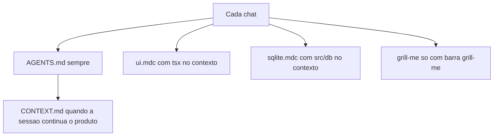

# Regras de IA do FinBack

Isto não implementa a SPA. Só deixa o repositório dizendo à IA como trabalhar, para o plano [`.cursor/plans/finback_spa_local_dad978ce.plan.md`](.cursor/plans/finback_spa_local_dad978ce.plan.md) ser executado em seguida sem reabrir essas decisões.

## O que aproveitar da recomendação

- Estilo Tailwind no mesmo arquivo do componente.
- SQL fora da tela. A UI chama funções prontas.
- Função pura (dinheiro, data, CSV no futuro) fora do componente.
- Sem abstração, herança ou padrão pesado.
- Comentário só do porquê, em especial OPFS e worker.
- Um arquivo de handoff entre sessões, em vez de Notion ou PDF.

## O que não copiar

- `.cursorrules` é legado. O Cursor usa [`AGENTS.md`](AGENTS.md) na raiz e [`.cursor/rules/*.mdc`](.cursor/rules). Um `.md` solto em `.cursor/rules` é ignorado.
- Não duplicar o mesmo texto em `AGENTS.md` e numa rule `alwaysApply`. Os dois entram no chat. O mapa fica no `AGENTS.md`; o detalhe entra só quando o arquivo daquele tipo está no contexto.
- Não criar `src/database/queries.ts` nem `src/services/` vazios. O plano já fixou o limite certo: SQL no worker, porque o OPFS SAH pool só entrega `SyncAccessHandle` fora da main thread. Um `queries.ts` único vira arquivo-deus e ainda assim não pode rodar SQL na UI.
- Não colar o esquema SQL dentro de rule nem do `CONTEXT.md`. A fonte da verdade, quando existir, é `src/db/schema.sql`. Copiar o `CREATE TABLE` faz a memória mentir na sessão seguinte.
- Não atualizar o `CONTEXT.md` a cada função. Só quando mudar esquema, persistência ou um fluxo visível.
- Não instalar o `grill-me` upstream do Matt Pocock como está. O `SKILL.md` publicado só diz para chamar outra skill (`grilling`) via ferramenta do Claude Code. No Cursor isso não dispara a entrevista. A skill do repositório leva o roteiro inteiro, curta, e só roda quando você digita `/grill-me`.

## O que o Cursor carrega

Texto em português, como a interface e o plano. Nomes de skill e de arquivo em inglês, que é o que o Cursor indexa.

## Arquivos

**[`AGENTS.md`](AGENTS.md)** — uma tela, sempre no contexto:

- FinBack é SPA local. Vite, React, TypeScript, Tailwind, React Router. SQLite WASM `@sqlite.org/sqlite-wasm`, VFS `opfs-sahpool`, conexão só no worker. Sem servidor e sem banco em memória. Centavos, BRL, textos da UI em português.
- Pastas: `src/components/` (tela e Tailwind juntos), `src/db/` (worker, client RPC, schema), `src/hooks/` (a UI fala com o client por aqui), `src/lib/` só quando houver função pura. `App.tsx` junta as rotas.
- Proibido: SQL em componente, segunda conexão, fallback em memória, camada `services/` ou `database/` antes de existir um caso real.
- No começo de uma sessão que continua o produto, ler [`CONTEXT.md`](CONTEXT.md). Ao fim de uma etapa (esquema, tela, persistência), atualizar só três blocos: o que funciona, ponteiro para o schema, próximo passo.
- Comentário explica decisão não óbvia. `// executa o SQL` não entra.

**[`CONTEXT.md`](CONTEXT.md)** — memória curta, commitada (o repo ainda não tem código):

- Funcionando: nada.
- Decisões já fechadas: as do plano (tipos de lançamento, saldo, uma aba, OPFS `.finback`).
- Banco: ainda não existe; o plano é a especificação até nascer `src/db/schema.sql`.
- Próximo: executar o plano da SPA.

**[`.cursor/rules/ui.mdc`](.cursor/rules/ui.mdc)** — `globs: src/**/*.tsx`, `alwaysApply: false`. Componente funcional no próprio arquivo, classe Tailwind nele, sem CSS separado. A página chama hook; o hook chama `src/db/client`. Extrair componente quando repetir ou o arquivo ficar difícil de ler, não antes. Dinheiro e data formatados por helper em `src/lib/` quando esse helper existir.

**[`.cursor/rules/sqlite.mdc`](.cursor/rules/sqlite.mdc)** — `globs: src/db/**/*`, `alwaysApply: false`. SQL e validação que o `CHECK` não cobre ficam no worker. O client só faz `postMessage`. `PRAGMA foreign_keys = ON`, `schema_migrations`, erros em português, `ON DELETE RESTRICT`. Exemplo de comentário bom: a conexão OPFS é assíncrona no worker porque `SyncAccessHandle` não existe na main thread.

**[`.cursor/skills/grill-me/SKILL.md`](.cursor/skills/grill-me/SKILL.md)** — `disable-model-invocation: true`. Entrevista uma ideia nova antes de codar: uma pergunta por vez, sem editar arquivo, sem reabrir o que `AGENTS.md` e o plano já fecharam, parar quando der para decidir. Serve para o próximo recurso, não para segurar o MVP já especificado.

Nada de hook, linter de estilo dentro de rule, nem skill só para reescrever o `CONTEXT.md`. Isso já cabe em poucas linhas do `AGENTS.md`.
